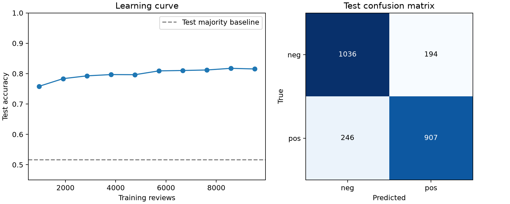

# Assignment 4: Text Classification with Naive Bayes

## Method and experimental setup

I implemented multinomial Naive Bayes from scratch using Python's `Counter`
and `math`, without a machine-learning toolkit. Matplotlib is used only for plots.
The supplied file contains 11,914 reviews from six topics: books, camera, dvd,
health, music, and software. Each line contains a topic, sentiment, document ID,
and tokens. Only the tokens are used as features; topic and ID are excluded.
The supplied lowercased tokenization is preserved, including punctuation.

Following the assignment example, the first `int(0.8 * 11914) = 9531` reviews
are used for training and the remaining 2,383 for evaluation. The supplied file
is already shuffled, so no additional shuffle is applied. Training contains
4,684 negative and 4,847 positive reviews; evaluation contains 1,230 negative
and 1,153 positive reviews. The vocabulary of 52,392 tokens is constructed
from training data only. No parameters are selected using evaluation labels.

For class c, the prior is its training document fraction. With Laplace smoothing
(alpha = 1), the token likelihood is

`P(w | c) = (count(w,c) + 1) / (total_tokens(c) + vocabulary_size)`.

The classifier maximizes

`score(c,d) = log P(c) + sum_w count(w,d) * log P(w | c)`.

Repeated tokens contribute repeatedly. Summing logs avoids numerical underflow.
The multinomial coefficient is omitted because it is identical across classes
for a given document. These scores are unnormalized class scores, not posterior
probabilities. Words outside the training vocabulary are ignored; a document
with no known words is classified using the priors. Smoothing assigns positive
likelihood to training-vocabulary words absent from a particular class. Exact
ties are resolved deterministically by sorted class order.

`read_documents`, `train_nb`, `score_doc_label`, `classify_nb`,
`classify_documents`, and `accuracy` are defined in `naive_bayes.py`.

## Sanity checks

For a one-token document, exponentiating the score gives the prior times the
smoothed word likelihood:

| Token | Negative score, exponentiated | Positive score, exponentiated | Prediction |
| --- | ---: | ---: | --- |
| great | 0.00052840 | 0.00132121 | pos |
| bad | 0.00045474 | 0.00017230 | neg |

Both directions agree with the assignment's sanity checks. The document
`['a', 'top-quality', 'performance']` is processed without error and classified
as positive. Independent tests verify hand-calculated smoothed likelihoods,
repeated-word contributions, likelihood normalization, handling of unknown
words, generic class labels, and invalid inputs. All three test methods pass.

## Evaluation

The classifier correctly labels **1,943 of 2,383 reviews: 81.54% accuracy**.
Always predicting the most common evaluation label would achieve 51.62%.
The 95% Wilson interval for accuracy is approximately **79.93%-83.04%**,
assuming independent evaluation observations and treating the fitted model as
fixed. It does not capture variability from different training splits or
possible dependence between reviews.

| True label | Predicted neg | Predicted pos |
| --- | ---: | ---: |
| neg | 1,036 | 194 |
| pos | 246 | 907 |

The model misses more positive reviews than negative reviews. All predictions,
source line numbers, topic/ID metadata, and score differences are recorded in
`results/predictions.csv` for inspection.

## Error analysis

I selected short misclassified reviews (at most 80 tokens), ordered by the
absolute difference between class scores. The examples are deliberately
selected failures, rather than a representative sample of all reviews. A large
score difference reflects the model's preference and does not guarantee a
well-calibrated probability. Full texts and the strongest token contributions
toward the incorrect class are saved in `results/error_examples.json`.
Line numbers below are one-based lines in the supplied file.

1. **Software, line 11288, 325.txt: true pos, predicted neg.** The review
   describes installation problems and an update error despite its positive
   label. The words `norton`, `error`, `antivirus`, and `problem` contribute
   strongly toward negative. A positive overall rating can coexist with a
   complaint-focused text; the available text gives limited positive evidence.
2. **Health, line 9849, 421.txt: true pos, predicted neg.** The writer complains
   that the company cannot be contacted but ends by saying the product is okay
   and they have not been sick. `contacting`, `company`, and `broke` outweigh
   this qualified approval. Independent token counts do not capture the
   contrast between customer service and product effectiveness, and do not
   interpret `havent been sick` compositionally.
3. **Camera, line 10624, 142.txt: true neg, predicted pos.** A camera bag is too
   small and cannot fit additional lenses, but the reviewer also says it fits
   nicely and can serve an informal purpose. `lens`, `bag`, `fits`, and `nicely`
   favor positive. Topic-associated vocabulary and qualified praise obscure
   the key size limitation; the model cannot interpret the scope of `cannot`.
4. **DVD, line 10149, 504.txt: true pos, predicted neg.** The reviewer calls
   the purchase a great deal but criticizes other collections and the surrounding
   ratings. Negative words such as `ridiculous` and `shoddy` target the comparison,
   rather than the purchased content. Bag-of-words counts lose that target.
5. **DVD, line 11090, 326.txt: true neg, predicted pos.** The text praises the
   cast and describes the episodes as a delight. The positive prediction is
   understandable; the supplied negative label appears inconsistent with the
   text. This suggests possible label noise, but the original rating is not
   supplied, so a labeling error cannot be established. Evaluation retains
   the original label.

These cases show limitations of conditional independence and word-order
invariance, along with ambiguity in the labels. Negation features and bigrams
could help some cases, but would require a separate validation protocol before
claiming an improvement. No such improvement is claimed here.

## Optional task: learning curve

I trained on nested prefixes containing 10%, 20%, ..., 100% of the training
partition and evaluated each model on the same fixed evaluation partition.
Each prefix builds its own vocabulary. Accuracy rises from 75.83% with 953
training reviews to 81.54% with 9,531 reviews, an increase of 5.71 percentage
points. Improvements diminish as the training set grows, and accuracy is not
strictly monotonic: the 90% prefix achieves 81.75%, slightly above the full
training set. More data changes both probabilities and vocabulary, so small
reversals are possible. A single prefix at each size does not quantify sampling
variability. The curve is descriptive and was not used to select a training size
or smoothing parameter. Values are in `results/learning_curve.csv`.

## Reproduction and scope

Run `MPLCONFIGDIR=.mplconfig .venv/bin/python HW4/run_assignment.py` from the
repository root, after installing `HW4/requirements.txt`. Run checks with
`.venv/bin/python -m unittest discover -s HW4 -p 'test_*.py'`.

This report covers all mandatory tasks plus the optional learning curve. The
other optional tasks have not been implemented.
